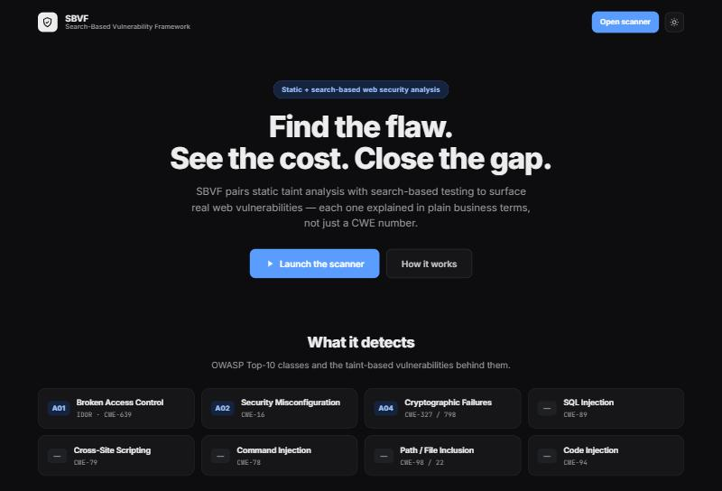
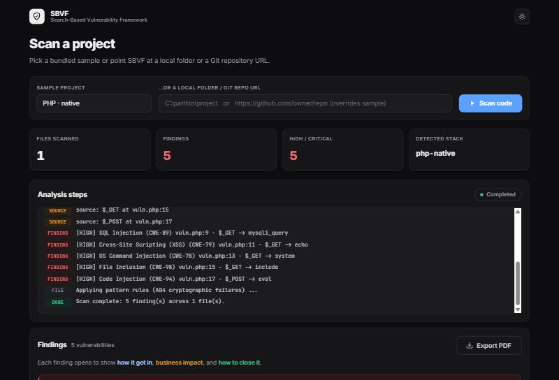
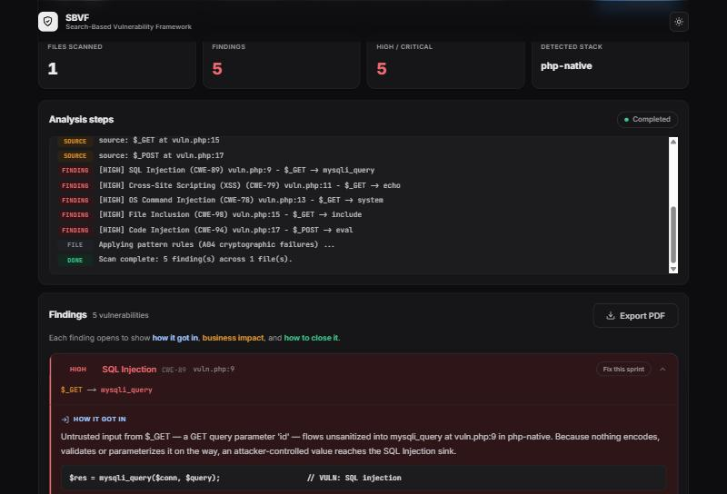

# SBVF — Search-Based Vulnerability Framework

Master's research prototype: a **search-based** framework that compares a Genetic
Algorithm (GA), Cuckoo Search (CS) and Random Search (RS) for detecting **XSS**,
**SQL Injection** and **Clickjacking** vulnerabilities in local web applications.

> Research title: *Design and Build a Search-Based Framework for Detecting Web
> Applications Vulnerabilities* — Tishreen University, Faculty of Informatics
> Engineering.

## Web dashboard

A modern Next.js dashboard (in `frontend/`) talks to the Python SSE backend: a
landing page, a live scanner that streams every analysis step, finding cards that
explain *how it got in*, *business impact* and *how to close it*, and a one-click
PDF report. Light and dark themes.

| Landing | Live scanner | Finding detail |
| --- | --- | --- |
|  |  |  |

Run it with Docker Compose (`docker compose up` → UI on `http://localhost:3000`,
API on `:8080`), or in dev with `python -m ui.server` and `npm run dev` in `frontend/`.

## Ethics & safety

All targets run on `127.0.0.1`. The framework **refuses non-local hosts** unless
`allow_remote=True` is passed explicitly for a target you are authorized to test.
The bundled apps are intentionally vulnerable and are for academic use only.

## Requirements

- **Python 3.12 or newer** (standard library only for the core; **no pip install needed**).
  The framework refuses to start on older interpreters. On Windows, if `python`
  points to an older version, use the launcher: `py -3.12 -m ui.server`,
  `py -3.12 -m tests.test_sast`, etc.
- Optional: `selenium` for real-browser confirmation of XSS/Clickjacking.
- Optional: Docker, to run the dashboard and the DVWA practice lab.

## Quick start

Run the real-time dashboard (it starts the benchmark apps for you):

```bash
python -m ui.server
# open http://127.0.0.1:8080
```

Run the full experiment from the command line:

```bash
python -m sbvf.experiment --split test --runs 30 --budget 250 --out results
```

Run the test suite:

```bash
python -m tests.test_framework
```

## Scanning a real open-source app

Point the framework at a real, locally-run open-source application (authorized local
testing only). It clones/downloads the project, launches it with the start command you
provide, crawls and tests it, then removes the clone:

```bash
python -m sbvf.scan_repo \
  --repo https://github.com/stamparm/DSVW \
  --start "python dsvw.py" \
  --base http://127.0.0.1:65412 \
  --endpoints /:id:sqli /:v:xss \
  --runs 15 --budget 60
```

The framework only talks to a local base URL; `--allow-remote` is required for anything
else and is intended solely for a local lab instance you are authorized to test.

### Bundled real-app targets (DVWA, OWASP Juice Shop)

```bash
docker compose --profile labs up -d dvwa juice-shop   # DVWA :8081, Juice Shop :3000
python -m sbvf.integrations --app all --runs 15 --budget 60
```

`sbvf/integrations.py` logs into DVWA (resets its DB, selects the "low" security level)
and targets Juice Shop's SQL-injectable product-search API. Observed result: the search
methods find the flaws in ~2 evaluations versus ~9–10 for the fixed-list Static baseline.

## Static source-code analysis (SAST)

Besides the dynamic, black-box search, SBVF ships a **static** analyzer that reads
a project's *source code*, detects the language and web framework, taint-tracks
untrusted user input from sources to dangerous sinks, and reports findings with
`file:line` precision. It never runs or contacts the application.

Supported stacks: **PHP** (native, Yii, Laravel), **Python** (native, FastAPI,
Django) and **Node.js** (native `http`, Express, NestJS — `.js`/`.ts`). Detected
classes include SQL injection, XSS, command/code injection, file inclusion, path
traversal, open redirect, SSRF and **IDOR / broken object-level access control**
(each mapped to a CWE).

IDOR (OWASP **A01**) is found by a different rule from the taint classes: a
request-controlled id reaching a by-id data fetch (Django `.objects.get`,
SQLAlchemy `query().get`, Mongoose/Sequelize/TypeORM `findById`/`findOne`,
Laravel `Model::find`) inside a handler that performs **no ownership or
authorization check**. Handlers that scope the query to the current user, or
carry an auth guard/decorator (`@login_required`, `@UseGuards`, `auth()->…`),
are treated as safe. It is reported statically only — unlike the injection
classes, the search cannot auto-confirm it (that needs two identities to prove
cross-owner access).

```bash
# scan a bundled sample, a local folder, or clone-scan-remove a remote repo
python -m sbvf.scan_code testbed/sast_samples/php_laravel
python -m sbvf.scan_code path/to/project --json report.json
python -m sbvf.scan_code https://github.com/user/project
```

The target is **either a local folder or a remote repository URL**. Remote
repositories must be public and hosted on **GitHub, GitLab or Bitbucket**
(`https://` only; other hosts, SSH, credentials and ports are rejected). They
are shallow-cloned into a temp folder with prompts and symlinks disabled,
scanned, and deleted. The dashboard's SAST tab accepts the same input; any local
folder is allowed while the dashboard listens on localhost, and local scans are
limited to the project folder if it is exposed with `SBVF_UI_HOST`.

Besides Django/FastAPI/PHP, stdlib `http.server` apps are understood too
(`self.path`/`self.headers` as sources, `self.wfile.write` and `Location`
headers as sinks) — e.g. scanning `https://github.com/stamparm/DSVW` reports
SQLi, command/code injection, path traversal, XSS and an open redirect.

For Node.js, `sbvf/sast/js.py` is a JS/TS lexer (template literals, regex
literals, ASI, decorators, block vs object-literal braces) plus a scoped taint
analysis: Express `req.query/params/body/files/cookies/headers`, NestJS
`@Query/@Param/@Body/@Headers/@Req` → `db.query`/`knex.raw`/`$queryRawUnsafe`,
`child_process.exec`, `eval`/`vm`/`mathjs.eval`/`node-serialize`, `fs.*`,
`axios`/`fetch`, `res.redirect`, `res.send`, strings returned by Nest handlers,
and server-side templates printing a tainted `res.render` value with an
unescaped construct — EJS `<%- %>`, Handlebars `{{{ }}}`, Pug `!=`/`!{}`.
Scanning `https://github.com/appsecco/dvna` reports its SQLi, command injection,
math.js and node-serialize RCEs, open redirect and EJS XSS — no false positives.

Every step streams into the dashboard's **Static analysis** tab
(`python -m ui.server`, then the 🧬 tab). Eight intentionally-vulnerable sample
projects live under `testbed/sast_samples/` (one per stack).

### Static-guided search (run the algorithm on a real codebase)

The static analyzer can **drive the search** instead of being a separate tool:
it taint-analyzes the source to discover injection points automatically, then
GA/CS/RS confirm which are actually exploitable against the running app — so you
never hand-write `--endpoints`.

```bash
python -m sbvf.scan_repo \
  --repo https://github.com/<user>/<php-app> \
  --start "php -S 127.0.0.1:8000" \
  --base http://127.0.0.1:8000 \
  --from-sast --web-root public \
  --runs 15 --budget 60
```

For a **Node.js** project the app can be launched automatically — no `--start`
needed. With `--node-install` it runs `npm install` first, then detects the start
command from `package.json` (`scripts.start`, `main`, or a conventional entry
file) and injects `PORT` from `--base`:

```bash
python -m sbvf.scan_repo \
  --repo https://github.com/<user>/<express-app> \
  --base http://127.0.0.1:3000 \
  --from-sast --node-install \
  --runs 15 --budget 60
```

Pipeline: **static taint analysis → candidate endpoints → GA/CS/RS confirmation.**
The static pass recovers the request parameter, input method and handler function
behind each finding; `sbvf/sast/bridge.py` turns confirmable findings into search
targets — **XSS, SQL injection, command injection and open redirect**, injected
through a **GET query parameter, a POST body, or a URL path segment**:

| Stack | How the URL is recovered |
|---|---|
| PHP (native) | file-routed: `shop/item.php` + `$_GET['id']` → `/shop/item.php?id=` |
| Django | `urls.py` `path()` patterns, incl. nested `include()` prefixes (`sbvf/sast/routes.py`) |
| FastAPI | `@app.get/...` decorators, `APIRouter(prefix=)`, `include_router(prefix=)` |
| Express | `app.get/post(...)`, `router.route()`, named handlers across `require`/`import`, `app.use('/prefix', router)` mounts |
| NestJS | `@Controller('x')` + `@Get(':id')`/`@Post()`…, `app.setGlobalPrefix()` |
| Laravel, Yii, native Python, native Node | not recovered → reported as *static-only* |

Findings the search cannot yet drive (code injection, path traversal, SSRF, file
inclusion, cookie/header inputs, or an unrecoverable route) are listed as
*static-only* with the reason, never silently dropped. This gives a precision
figure — how many statically-reported points the search proves exploitable — and
runs the algorithm
on real open-source code, not just the benchmark apps.

## Next.js frontend (optional)

A modern React/Next.js client lives in `frontend/`. It reuses the Python SSE API
(`ui/server.py`) as its backend — the stdlib core is unchanged — and renders the
live scan stream, the finding cards (how it got in / business impact / how to
close it) and the PDF export as a React app.

```bash
python -m ui.server                 # backend API on 127.0.0.1:8080
cd frontend && npm install && npm run dev   # frontend on http://localhost:3000
```

`frontend/app/api/[...path]/route.ts` proxies `/api/*` to the Python backend as a
streaming route handler (so Server-Sent Events are forwarded live); point it at a
different backend with `SBVF_API_ORIGIN`. The original single-file dashboard at
`http://127.0.0.1:8080` remains available and needs no build step.

## Docker

```bash
docker compose up sbvf                 # dashboard at http://localhost:8080
docker compose --profile labs up       # also starts DVWA at http://localhost:8081
```

## Layout

```
sbvf/        framework: individual, fitness, oracles, algorithms, stats, datasets, experiment
sbvf/sast/   static analyzer: model, detect, php, python_analyzer, js, routes, bridge, repo, engine
testbed/     intentionally-vulnerable apps (bank, blog, shop, wafapp, authapp) + launcher
testbed/sast_samples/  vulnerable source projects for the static analyzer (8 stacks)
ui/          real-time dashboard (SSE server + HTML; dynamic + static tabs)
tests/       unit + integration tests (dynamic + static)
docs/        thesis chapters (Arabic)
results/     generated CSV/JSON results
```

## Datasets

The benchmark endpoints are split (stratified) into `TRAIN` (parameter tuning) and
`TEST` (held-out, reported results) in `sbvf/datasets.py`, spanning an easy→hard
difficulty tier so the search's advantage (or lack of it) can be observed honestly.

## Metrics

- **Recall** on vulnerable endpoints and **false-positive rate** on safe endpoints.
- **Evals-to-first-detection** (efficiency), compared pairwise with the non-parametric
  **Mann-Whitney U** test and the **Vargha-Delaney Â12** effect size.
